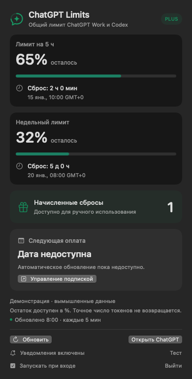
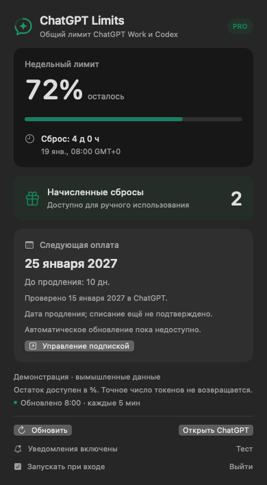

# ChatGPT Limits для macOS

Нативный индикатор лимитов ChatGPT Work / Codex в строке меню Mac. Поддерживает **Plus и Pro**, показывая параметры текущего аккаунта, полученные от сервиса.

[English](README.md) · [Участие в разработке](CONTRIBUTING.md) · [Подготовка релиза](docs/RELEASING.md)

Независимый неофициальный проект, не связанный с OpenAI. Интерфейс — на русском.

## Установка без Терминала

**[Скачать ChatGPT Limits 1.3.6 — DMG](https://github.com/Nazhmetdinov/chatgpt-limits-macos/releases/download/v1.3.6/ChatGPT-Limits-v1.3.6-macOS-universal.dmg)** — один файл для Apple Silicon и Intel. [Все файлы релиза](https://github.com/Nazhmetdinov/chatgpt-limits-macos/releases/latest). Нужны macOS 13+ и установленный ChatGPT или Codex с выполненным входом; Swift и инструменты разработки не нужны.

1. Скачайте и откройте DMG.
2. Перетащите **ChatGPT Limits** на папку **Applications («Программы»)**.
3. Запустите приложение из «Программ» и разрешите уведомления. В верхней строке меню появится **GPT**. Извлеките диск ChatGPT Limits в Finder.

Внутри DMG есть инструкция **Install.html**. Перед обновлением завершите индикатор и замените приложение в той же папке, где установлена старая версия.

Текущий DMG ещё не подписан Developer ID и не прошёл notarization. Поэтому macOS может потребовать действие «Всё равно открыть» в разделе «Конфиденциальность и безопасность» после попытки запуска, если вы доверяете источнику. [Инструкция Apple](https://support.apple.com/102445). Для обычного публичного релиза сопровождающему предстоит настроить подпись и notarization.

**Plus — два периода**



**Pro — недельный период**



Изображения созданы на **вымышленных данных**. Наличие периодов и дополнительных сбросов определяется ответом сервиса.

## Что показывает

| Параметр | Plus | Pro |
| --- | --- | --- |
| Периоды | Пять часов; неделя, если сервис её возвращает | Неделя; сейчас без пятичасового периода |
| Пример строки меню | `GPT 5ч 65%/2ч · 7д 32%/5д · ↻1` | `GPT 72% · 4д · ↻2` |
| Значение | Период, остаток, время до сброса | Остаток, время до сброса |
| Дополнительные сбросы | Доступное количество или `—`, если неизвестно | Доступное количество или `—`, если неизвестно |

`д`, `ч`, `м` — дни, часы и минуты; `↻` — дополнительные сбросы. В панели видны все категории, точное местное время сброса и детали начислений, когда они доступны. Знак `!` означает устаревшие данные. По истечении срока приложение ждёт подтверждения нового периода от сервиса.

Сервис возвращает **проценты, а не точное количество оставшихся токенов**. Это лимиты Work / Codex, а не обычных бесед ChatGPT или API-биллинга. Название тарифа, длительность окон и доступные сбросы определяет сервер. Условия могут меняться: [официальные лимиты](https://learn.chatgpt.com/docs/pricing), [протокол App Server](https://learn.chatgpt.com/docs/app-server).

## Управление подпиской

Кнопка **«Управление подпиской»** открывает настройки подписки ChatGPT в новой вкладке Chrome/Chromium, Edge, Brave, Vivaldi или Firefox, если этот браузер выбран по умолчанию. Safari и другие браузеры используют собственную настройку открытия внешних ссылок. Если открытых окон нет, браузер создаст окно. Индикатор не требует отдельного окна входа, расширения браузера или режима разработчика.

Карточка **«Следующая оплата»** показывает локально сохранённую проверенную дату для текущего аккаунта и тарифа, если такая запись есть; иначе — **«Дата недоступна»**. Видно, когда дата проверена на странице подписки ChatGPT. Через сутки появляется просьба проверить актуальность; приложение не переносит дату на следующий месяц самостоятельно. Пока запись создаётся только при проверке с помощником: обычная установка сама дату не импортирует. Автоматического обновления даты в этой версии нет: ответ установленного клиента с лимитами не содержит платёжных дат. Приложение не вычисляет их из сроков сброса лимитов. Платежи управляются через сервис, где оформлена подписка: ChatGPT, App Store, Google Play или другого поставщика.

## Уведомления

- **Осталось строго меньше 10%:** один раз за период каждого лимита. Ровно 10% не вызывает уведомление. Если при запуске остаток уже ниже порога, предупреждение придёт после получения данных.
- **Лимит сбросился:** когда свежий ответ подтверждает новый период. Истечение таймера само по себе не считается сбросом.
- **Начислен дополнительный сброс:** при увеличении доступного количества либо появлении нового идентификатора начисления, даже если общий остаток не изменился.

Пятичасовое и недельное окна Plus отслеживаются отдельно. Первый ответ задаёт исходное состояние: имеющиеся сбросы не объявляются новыми. Пропуски полей и перезапуски не дублируют события. При обнаруженной смене тарифа создаётся новый исходный уровень. Очередь хранится до суток; неактуальные предупреждения о низком остатке удаляются раньше.

При запросе macOS разрешите уведомления. В панели есть их статус, переход к системным настройкам и кнопка **«Тест»**. Настройки фокусирования, баннеров и звука macOS сохраняют приоритет. Обновление — раз в пять минут, при пробуждении и вручную; приложение должно работать. Если начисление и расход произошли между проверками, баланс не изменился и сервис не вернул детали, событие обнаружить невозможно.

## Сборка из исходников — для разработчиков

Нужны **macOS 13+**, **Swift 6 / Xcode Command Line Tools** и установленный ChatGPT или Codex с выполненным входом в поддерживаемый аккаунт ChatGPT. API-ключ не нужен. Если инструментов разработки нет: `xcode-select --install`.

```sh
swift run --disable-sandbox LimitsChecks
bash scripts/build.sh
bash scripts/install.sh
```

Установка: `~/Applications/ChatGPT Limits.app`. В Dock приложение не появляется. При первом старте регистрируется автозапуск; отключить его можно переключателем **«Запускать при входе»**. Иногда macOS требует подтверждения в настройках объектов входа. Разрешение на уведомления выдаётся отдельно.

Перед обновлением завершите индикатор. Скрипт сохраняет и проверяет резервную копию предыдущей версии в `dist/backups`. Для отката завершите приложение и скопируйте резервную копию обратно в `~/Applications/ChatGPT Limits.app`.

Сборка имеет **ad-hoc подпись**, без notarization. Команда `bash scripts/build.sh --universal` собирает приложение сразу для Apple Silicon и Intel. `bash scripts/package-release.sh` создаёт DMG, ZIP и контрольные суммы. В CI настроены проверки на обеих архитектурах; локально проверен запуск arm64, а x86_64 собран перекрёстной компиляцией.

## Устройство и данные

Приложение запускает установленный `codex app-server`, отправляет только `initialize` и `account/rateLimits/read`, затем завершает дочерний процесс. Использует существующий вход клиента, не читает и не копирует файлы авторизации, не запускает модель, не покупает кредиты и не тратит дополнительные сбросы. Авторизацию и сетевые обращения выполняет установленный клиент.

Приоритет имеет `rateLimitsByLimitId`, запасной вариант — `rateLimits`. Количество сбросов берётся из `availableCount`, а не из длины списка подробностей. Неизвестные значения остаются неизвестными.

У индикатора нет телеметрии. В настройках macOS сохраняется состояние для уведомлений: предыдущие проценты, сроки, количество и идентификаторы начислений, очередь событий. Если сервер сообщает ID аккаунта, сохраняется только его SHA-256 отпечаток. Полные ответы и секреты не сохраняются в этих настройках. Необязательный приватный файл `verified-billing.json` в папке Application Support этого индикатора содержит только отпечаток аккаунта, тариф, проверенную дату продления, источник и время проверки — без счетов и платёжных реквизитов. Если ID отсутствует, переключение между аккаунтами одного тарифа не всегда распознаётся; очистка настроек закрытого приложения сбрасывает исходное состояние и историю уведомлений.

## Проверки

```sh
# Без аккаунта и сети
swift run --disable-sandbox LimitsChecks

# Текущий аккаунт без интерфейса
"dist/ChatGPT Limits.app/Contents/MacOS/ChatGPTLimits" --check

# Демонстрации на вымышленных данных
bash scripts/render-previews.sh

# Аудит файлов для GitHub и упаковка приложения
python3 scripts/audit-release.py
bash scripts/package-release.sh
```

`--check` выводит краткую сводку без секретов и ID аккаунта. Не публикуйте диагностику реального аккаунта. Инструкции по публикации: [RELEASING.md](docs/RELEASING.md).

Лицензия [MIT](LICENSE).
